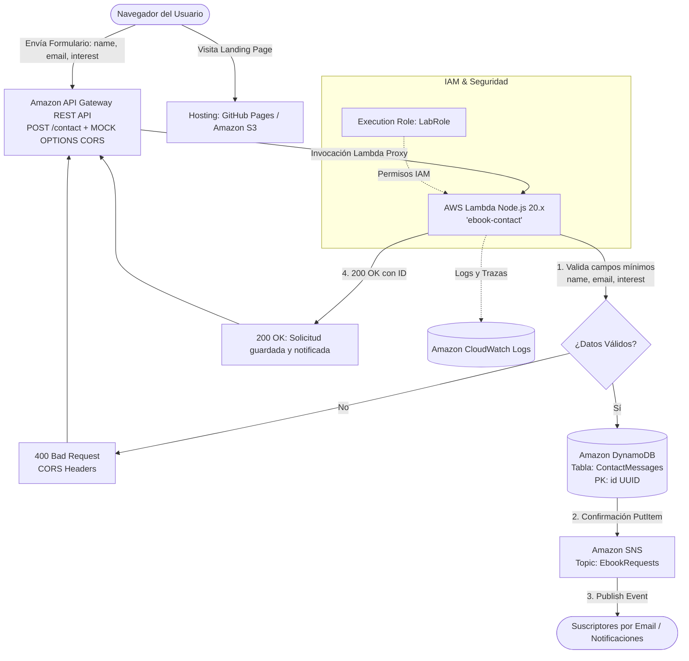

# NEXUS ARENA 2026 · Torneo de eSports (EventPass Serverless)

> **Misión Serverless | Arquitectura Cloud en AWS Academy**  
> Solución completa de registro de participantes con validación en backend, persistencia NoSQL, mensajería Pub/Sub e Infraestructura como Código (IaC).

---

## 1. URLs Públicas del Proyecto

| Servicio / Recurso | Tipo | URL Pública / Endpoint |
| :--- | :--- | :--- |
| **Frontend GitHub Pages** | Web Hosting | [https://romanchornobai.github.io/torneo-esports-serverless/](https://romanchornobai.github.io/torneo-esports-serverless/) |
| **Frontend Amazon S3** | Static Website | [http://torneo-esports-romanchornobai-2026.s3-website-us-east-1.amazonaws.com](http://torneo-esports-romanchornobai-2026.s3-website-us-east-1.amazonaws.com) |
| **REST API Gateway (Dev)** | Endpoint HTTP | `https://99mr1udul5.execute-api.us-east-1.amazonaws.com/dev/contact` |
| **Terraform API Gateway** | Endpoint IaC | `https://hd65cv5g7e.execute-api.us-east-1.amazonaws.com/dev/contact` |
| **Repositorio GitHub** | Código Fuente | [https://github.com/romanchornobai/torneo-esports-serverless](https://github.com/romanchornobai/torneo-esports-serverless) |

---

## 2. Diagrama de Arquitectura



---

## 3. Justificación de Decisiones Arquitectónicas

### 3.1. Campos Mínimos del Formulario (Caso: EventPass / eSports)
El formulario implementa de manera estricta los tres campos mínimos exigidos por la rúbrica:
1. **`name`** (obligatorio): Nombre o gamertag del jugador.
2. **`email`** (obligatorio): Correo electrónico para el envío de acreditaciones y emparejamientos.
3. **`interest`** (obligatorio): Disciplina eSports seleccionada (*Valorant 5v5*, *League of Legends*, *Counter-Strike 2*, *Rocket League*).

El backend valida los tres atributos en el servidor independientemente de la validación del navegador. Si falta alguno, devuelve `400 Bad Request` con mensaje explicativo.

### 3.2. ¿Por qué Amazon DynamoDB y por qué `id` como Partition Key?
- **Patrón de Acceso (Access Pattern):** El sistema requiere almacenar cada solicitud de inscripción entrante con alta concurrencia y baja latencia ($<10\text{ ms}$). No se requieren operaciones de agregación complejas ni relaciones foráneas (*JOINs*).
- **Elección de la Partition Key:** Se utiliza un **UUID v4 (`crypto.randomUUID()`)** como Partition Key (`id`) en lugar del `email`. Si usáramos `email` como clave primaria, un jugador no podría inscribirse a torneos futuros o disciplinas distintas sin sobreescribir su registro anterior. El UUID asegura que cada solicitud es inmutable y única.
- **¿Cuándo conviviría con una base relacional (RDBMS)?:** Si la organización necesitase cuadrar tablas de clasificación históricas con múltiples llaves foráneas entre equipos, árbitros y pagos contables con transacciones ACID distribuidas, un motor SQL como Amazon Aurora PostgreSQL complementaría a DynamoDB.

### 3.3. IAM: Execution Role vs Credenciales de Usuario
- **Tus Credenciales de Usuario / CLI:** Pertenecen a tu sesión del Learning Lab (`voclabs/user...`) y se utilizan para desplegar recursos desde la consola o terminal.
- **Execution Role de Lambda (`LabRole`):** Es la identidad de servicio asumida por AWS Lambda en tiempo de ejecución. Lambda no usa tus claves personales; opera con las políticas adjuntas a su rol (`dynamodb:PutItem`, `sns:Publish`, `logs:CreateLogStream`, `logs:PutLogEvents`).

### 3.4. Desacoplamiento Pub/Sub con Amazon SNS
En lugar de forzar a Lambda a enviar un correo directamente mediante un cliente SMTP acoplado, Lambda únicamente emite un evento al topic **`EbookRequests`**. Esto aporta:
- **Desacoplamiento:** El productor (Lambda) no necesita conocer qué o cuántos suscriptores existen.
- **Extensibilidad:** Se pueden añadir nuevos suscriptores (colas SQS para procesamiento asíncrono, lambdas analíticas, alertas SMS) sin modificar una sola línea de código del backend.

---

## 4. Instrucciones de Prueba Paso a Paso (cURL / HTTP)

### Prueba 1: Petición Exitosa con los 3 Campos (200 OK)
```bash
curl -i -X POST "https://99mr1udul5.execute-api.us-east-1.amazonaws.com/dev/contact" \
  -H "Content-Type: application/json" \
  -d '{"name":"Alex Phoenix","email":"alex.phoenix@esports.com","interest":"Valorant 5v5"}'
```
**Respuesta esperada:**
```json
HTTP/1.1 200 OK
Content-Type: application/json
Access-Control-Allow-Origin: *

{
  "success": true,
  "message": "Solicitud guardada y notificada correctamente",
  "id": "1ca02034-3316-4b93-8253-101a743da9de",
  "interest": "Valorant 5v5"
}
```

### Prueba 2: Petición con Datos Incompletos (400 Bad Request)
```bash
curl -i -X POST "https://99mr1udul5.execute-api.us-east-1.amazonaws.com/dev/contact" \
  -H "Content-Type: application/json" \
  -d '{"name":"Alex Phoenix","email":"alex.phoenix@esports.com"}'
```
**Respuesta esperada:**
```json
HTTP/1.1 400 Bad Request
Content-Type: application/json
Access-Control-Allow-Origin: *

{
  "success": false,
  "error": "Name, email e interest son obligatorios"
}
```

### Prueba 3: Negociación CORS Preflight (OPTIONS)
```bash
curl -i -X OPTIONS "https://99mr1udul5.execute-api.us-east-1.amazonaws.com/dev/contact"
```
**Respuesta esperada:**
```
HTTP/1.1 200 OK
Access-Control-Allow-Origin: *
Access-Control-Allow-Methods: POST,OPTIONS
Access-Control-Allow-Headers: Content-Type,X-Amz-Date,Authorization,X-Api-Key,X-Amz-Security-Token
```

---

## 5. Verificación en AWS CLI

### Consultar registros en DynamoDB
```bash
aws dynamodb scan --table-name ContactMessages --query "Items[].{ID:id.S, Name:name.S, Email:email.S, Interest:interest.S, Timestamp:timestamp.S}" --output table
```

### Verificar Topic y Suscripciones en SNS
```bash
aws sns list-topics --query "Topics[?contains(TopicArn, 'EbookRequests')]"
aws sns list-subscriptions-by-topic --topic-arn "arn:aws:sns:us-east-1:014181419088:EbookRequests"
```

### Consultar Logs en CloudWatch
```bash
aws logs describe-log-streams --log-group-name "/aws/lambda/ebook-contact" --order-by LastEventTime --descending --max-items 1
```

---

## 6. Infraestructura como Código (Terraform)

En la carpeta `terraform/` se encuentra la especificación completa del sistema:
- `versions.tf` / `variables.tf`: Declaración del provider AWS ~> 5.0 y variables parametrizables.
- `main.tf`: Declaración de DynamoDB (`ContactMessagesTF`), SNS (`EbookRequestsTF`), Lambda (`ebook-contact-tf`) y API Gateway con preflight OPTIONS.
- `outputs.tf`: Salidas con las URLs y ARNs de la infraestructura aprovisionada.

### Comandos de Ciclo de Vida:
```bash
cd terraform
terraform init
terraform fmt
terraform validate
terraform plan
terraform apply -auto-approve
terraform output
terraform plan -destroy
```

---

## 7. Rúbrica de Evaluación y Checklist de Seguridad

- [x] **Sin Credenciales Expuestas:** El repositorio no contiene credenciales de AWS, `aws_session_token`, ni claves privadas (verificado con `.gitignore` para `.aws/`, `*.tfstate`, variables de entorno).
- [x] **Frontend Responsivo:** Web temática de eSports con diseño moderno dark/cyberpunk, adaptado a móviles y escritorios.
- [x] **Tres Campos Mínimos:** Formulario con `name`, `email` e `interest` validados en cliente y servidor.
- [x] **Doble Alojamiento:** Operativo en **GitHub Pages** y **Amazon S3 Website**.
- [x] **REST API & CORS:** API Gateway configurado con integración proxy y soporte completo para peticiones preflight `OPTIONS`.
- [x] **Persistencia:** DynamoDB en modo bajo demanda (`PAY_PER_REQUEST`) con clave de partición UUID.
- [x] **Notificaciones:** Topic SNS con suscripción de correo confirmable y publicación atómica post-persistencia.
- [x] **Observabilidad:** Invocaciones registradas y auditadas en Amazon CloudWatch Logs.
- [x] **Terraform Reproducible:** Proyecto IaC validado, planificado y probado de extremo a extremo.
